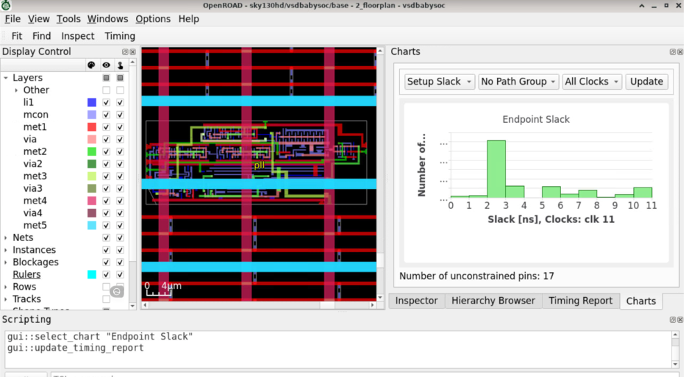
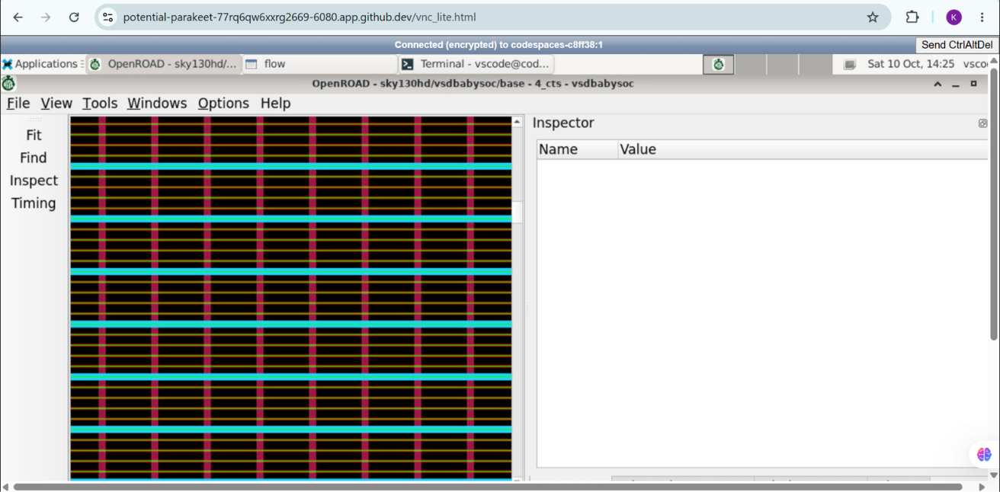
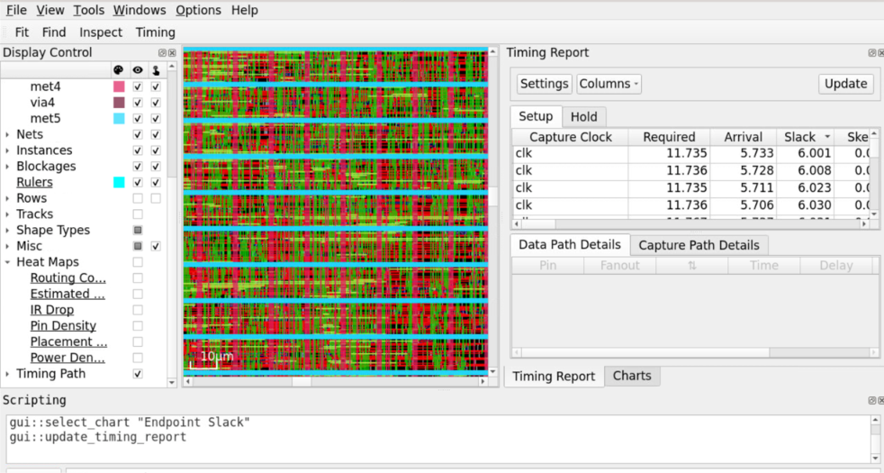

# VSD BabySoC — OpenROAD post-route evidence

## Overview

This folder contains OpenROAD GUI screenshots associated with BabySoC floorplanning, placement, clock-tree synthesis, and routing, plus a PDF named [`post_route_sta_16_corners.pdf`](./post_route_sta_16_corners.pdf). No RTL, constraints, TCL scripts, logs, OpenROAD database, or extracted timing data are included.

The artifact names and GUI views document the visible flow stages. They do not, by themselves, prove that every stage completed successfully, that the design passed design-rule checks, or that all timing requirements were met.

## Floorplan and macro views

The floorplan screenshots show the design with named macros `dac` and `pll` in OpenROAD. The [DAC view](./Floorplan_dac_gui.png) identifies its macro as locked in the displayed inspector. The PLL image also shows a timing-slack chart with 17 unconstrained pins; this is a material constraint caveat and should be resolved/reviewed before treating timing conclusions as signoff.

The macro names indicate DAC- and PLL-related blocks in the shown floorplan. The screenshots do not include macro abstracts, dimensions, pin constraints, or floorplan scripts, so macro integration details cannot be reconstructed from the images alone.

*Floorplan/timing-chart view; the GUI reports 17 unconstrained pins.*

## Placement

The supplied screenshots are associated with placement and a [zoomed placement view](./Placement_Zoomed.png). They show GUI views of the design, not the placement logs or legality report.

*OpenROAD placement-stage view.*

## CTS and routing

The following screenshots are associated with the CTS and routing GUI stages. No CTS skew report, routing completion log, DRC report, or detailed route metrics are supplied alongside them.

*OpenROAD CTS-stage view.*

*OpenROAD routing-stage view.*

## Post-route static timing analysis

[`post_route_sta_16_corners.pdf`](./post_route_sta_16_corners.pdf) is the available post-route STA document; its filename indicates a 16-corner report. The PDF's detailed contents have not been transcribed into this README. Review its constraints, corner definitions, unconstrained paths, setup/hold results, and worst slack before making any timing-closure claim. The PLL GUI screenshot notes 17 unconstrained pins, so the completeness of constraints needs particular attention.

### Review checklist for the PDF

For each mode/corner, record worst setup slack and worst hold slack, total negative slack if reported, failing endpoint/path counts, and unconstrained paths. Confirm that clock and I/O constraints apply to the intended interfaces and that the report is post-route with the expected parasitic assumptions. Favorable slack does not establish closure if relevant endpoints are unconstrained or the intended operating corner is missing. Cite the PDF directly in an evaluation; this guide does not claim specific slack values or a pass/fail outcome.

## Evidence gaps

For an independently reviewable implementation result, provide the relevant RTL/netlist, SDC and other constraints, PDK/library versions, flow configuration and commands, stage logs, DRC/antenna results, and machine-readable timing reports. They are not present in this folder.

[Workshop index](../README.md) · [PD program](../PD%20program/README.md)
