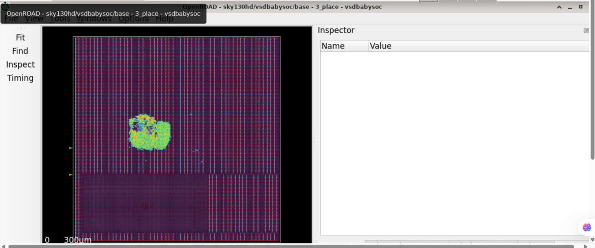

# RTL Design Workshop and VSD BabySoC Evidence

This repository collects visual evidence from RTL-design workshop exercises and a BabySoC physical-design flow. It is organized as day-wise workshop folders, a five-module physical-design program, and separate BabySoC simulation and OpenROAD post-route artifacts.

> **Evidence scope:** The checked-in technical artifacts are PNG screenshots and one post-route STA PDF. No RTL/SystemVerilog/VHDL sources, testbenches, simulation dump files, flow scripts, configuration files, or raw tool logs are present. The screenshots and report can be inspected, but the original runs cannot be reproduced from this repository alone. Descriptions below avoid treating a screenshot as proof of a full signoff or verified pass.

## Contents

- [Workshop overview](#workshop-overview)
- [Day-by-day materials](#day-by-day-materials)
- [Physical-design program](#physical-design-program)
- [BabySoC simulation evidence](#babysoc-simulation-evidence)
- [BabySoC physical-design evidence](#babysoc-physical-design-evidence)
- [RTL review and reproducibility](#rtl-review-and-reproducibility)
- [Selected evidence](#selected-evidence)
- [Learning summary](#learning-summary)
- [References and acknowledgement](#references-and-acknowledgement)

## Workshop overview

The day folders document topics ranging from combinational MUX logic and sequential logic to assignment semantics, completeness, and a sequence-detector exercise. The directory names and screenshot labels provide the available evidence for the activities. They do not include source code or executable examples.

The physical-design materials are divided between the [`PD program`](./PD%20program/README.md), which contains five topic modules represented by screenshots, and a separate [BabySoC OpenROAD post-route folder](./PostRoute_STA_VSDBabySOC_OpenRoad/README.md).

### Learning objectives represented

- Relate RTL concepts such as selection logic, registers, and combinational completeness to waveforms and synthesis views.
- Read simulation and synthesis screenshots as evidence, while recognizing their limits without source, testbench, or logs.
- Identify the major physical-design stages shown in the repository: floorplanning, placement, CTS, routing, and timing analysis.
- Use clear, reproducible project documentation and link implementation claims to available artifacts.

### Workshop progression

| Stage | Main ideas represented | Review question |
| --- | --- | --- |
| DAY_1 | Combinational logic and 2:1 MUX selection | Does the output follow the selected input? |
| DAY_2 | DFFs, reset behavior, and module hierarchy | When does state update, and how does reset act? |
| DAY_3 | Constant propagation and synthesis optimization | What logic remains after optimization? |
| DAY_4 | Blocking/non-blocking semantics and MUX RTL | Do simulation scheduling and intended state behavior agree? |
| DAY_5 | Complete assignments, latch inference, and generate logic | Are outputs assigned on every combinational path? |
| DAY_6 | BabySoC pre-/post-synthesis waveform views | Are the same signals and stimulus available for comparison? |
| DAY_7 | Sequence-detector logic, waveforms, and synthesis statistics | Do behavior and implementation match the design specification? |

### Tools named in the material

The existing workshop notes refer to Icarus Verilog, GTKWave, and Yosys. Physical-design material and screenshots name or show OpenLane, OpenROAD, SkyWater `sky130A`, Magic, and ngspice. Tool versions, exact run commands, environment setup instructions, and PDK/library revisions are not recorded here.

## How to use this repository

1. Start with the relevant day or module guide.
2. Read its concept summary before interpreting an image; a screenshot is a view of a result, not a complete record of design inputs.
3. Use the evidence tables in each guide to find screenshots and understand what each one is associated with.
4. Treat RTL examples and command patterns in guides as educational guidance, not a claim that their source files exist in this repository.
5. For reproducibility, provide the design/testbench or flow inputs, tool versions, exact commands, and raw outputs needed to assess a result.

## Day-by-day materials

| Folder | Topics/evidence | Guide |
| --- | --- | --- |
| DAY_1 | 2:1 multiplexer screenshots | [DAY_1 README](./DAY_1/README.md) |
| DAY_2 | DFF/reset and hierarchy-related screenshots | [DAY_2 README](./DAY_2/README.md) |
| DAY_3 | Constant-input DFF, counter, and Yosys optimization screenshots | [DAY_3 README](./DAY_3/README.md) |
| DAY_4 | Blocking/non-blocking examples and MUX screenshots | [DAY_4 README](./DAY_4/README.md) |
| DAY_5 | Case/if completeness, generated logic, and RCA screenshots | [DAY_5 README](./DAY_5/README.md) |
| DAY_6 | Pre- and post-synthesis BabySoC waveform screenshots | [DAY_6 README](./DAY_6/README.md) |
| DAY_7 | Sequence-detector diagram, waveforms, and Yosys statistics screenshot | [DAY_7 README](./DAY_7/README.md) |

## Repository structure

```text
.
├── DAY_1/ … DAY_7/                 Workshop evidence and day guides
├── PD program/
│   ├── module1/ … module5/         Physical-design module evidence/guides
│   └── README.md                   Program index
├── PostRoute_STA_VSDBabySOC_OpenRoad/
│   ├── README.md                   BabySoC OpenROAD/STA evidence guide
│   └── post_route_sta_16_corners.pdf
└── README.md                       Repository entry point
```

## Physical-design program

[`PD program/README.md`](./PD%20program/README.md) is the index to the module guides:

1. [Module 1 — environment and synthesis screenshots](./PD%20program/module1/README.md)
2. [Module 2 — floorplan and placement screenshots](./PD%20program/module2/README.md)
3. [Module 3 — CMOS inverter and ngspice-related screenshots](./PD%20program/module3/README.md)
4. [Module 4 — configuration, libraries, tracks, and synthesis screenshots](./PD%20program/module4/README.md)
5. [Module 5 — CTS, placement, and routing screenshots](./PD%20program/module5/README.md)

The modules contain image artifacts, not the actual designs, TCL configuration, constraints, scripts, logs, or generated layout databases. Refer to each guide for the exact evidence available and the limitations on reproducing or validating the flow.

### Physical-design stage context

The stages represented in the PD material fit into a typical implementation sequence:

1. **Environment and synthesis:** select technology libraries, read RTL, and produce a logic netlist.
2. **Floorplanning:** establish the die/core region, I/O arrangement, macro locations, and physical constraints.
3. **Placement:** assign standard cells to legal sites and assess timing and congestion.
4. **Clock-tree synthesis:** construct a clock distribution network and evaluate skew and insertion delay.
5. **Routing:** connect placed cells using technology routing layers, then run relevant checks.
6. **Static timing analysis:** evaluate constrained timing paths for specified modes and corners.

This is general flow context, not a claim that each stage completed in every screenshot. The PD program examples and the BabySoC implementation evidence are documented separately.

## BabySoC simulation evidence

[`DAY_6`](./DAY_6/README.md) contains two GTKWave screenshots labeled pre-synthesis and post-synthesis. Signal labels include `CLK`, `OUT`, `RV_TO_DAC[9:0]`, and control/reference signals. These screenshots provide visual waveform evidence; there is no HDL/testbench source, VCD, or comparison log with which to verify equivalence or explain the stimulus.

## BabySoC physical-design evidence

The [post-route guide](./PostRoute_STA_VSDBabySOC_OpenRoad/README.md) documents the available OpenROAD GUI screenshots and [`post_route_sta_16_corners.pdf`](./PostRoute_STA_VSDBabySOC_OpenRoad/post_route_sta_16_corners.pdf). The images are labeled as floorplan, placement, CTS, and routing views. Their presence records flow progress, but does not by itself prove that every stage completed successfully or that timing/signoff criteria were met. Review the PDF's corner-by-corner details and constraints before making a timing-closure claim.

The PLL floorplan screenshot displays **17 unconstrained pins**. This means the timing context requires review: paths at unconstrained endpoints cannot be assessed as though they had been checked against valid timing requirements. The PDF is named for 16 corners, but the actual corner results and closure status should be read from the PDF rather than inferred from its filename.

## RTL review and reproducibility

### Review checklist for RTL exercises

- Confirm the intended function and write down the truth table or state-transition behavior before interpreting a waveform.
- Check reset polarity, assertion/deassertion behavior, and clock edge for sequential logic.
- Use non-blocking assignments for clocked state and complete assignments for combinational outputs.
- Exercise boundary and exceptional cases, not only a representative waveform.
- Review synthesis warnings and inferred latches/registers rather than judging the implementation from RTL appearance.
- For RTL-versus-GLS comparison, use consistent stimulus and account for gate delays and initialization semantics.

### Generic tool flow

The examples below show a typical workflow, **not commands that can currently be run from this repository**. There are no design sources, testbenches, or VCD files checked in. Replace filenames and top-module names with the files from the design being evaluated.

```bash
# Compile RTL and a testbench with Icarus Verilog
iverilog -g2012 -o sim.out design.v tb_design.v

# Run the simulation; the testbench must include a waveform dump if one is needed
vvp sim.out

# Open the VCD file produced by the testbench
gtkwave dump.vcd
```

A generic Yosys structural check can be run after adapting the input and top name:

```bash
yosys -p "read_verilog design.v; hierarchy -top top; proc; opt; check; stat"
```

Technology mapping and physical-design flows require the appropriate target libraries, constraints, PDK, and flow setup; this generic command does not produce a signoff implementation.

### Suggested evidence package

For an academic evaluation that expects results to be reproducible, supplement the screenshots with:

1. RTL and testbench source, including the top module and interface description.
2. Simulator/synthesis/physical-design tool versions and exact commands or scripts.
3. Raw waveform, synthesis logs/netlists, and relevant physical-design reports.
4. Timing constraints, library/PDK version, and the mode/corners used for analysis.
5. A concise result summary that identifies measured values and links each claim to its report.

Do not include credentials or unrelated personal files in the submission.

## Selected evidence

### Sequence-detector logic view

The synthesis graph screenshot shows the logic and state elements associated with a design labeled `sequence_detector`.


*Figure 1. Synthesis logic graph labeled `sequence_detector`.*

### BabySoC waveform

This GTKWave screenshot is labeled as a pre-synthesis simulation and displays BabySoC-related signal names.


*Figure 2. Pre-synthesis GTKWave view of the BabySoC testbench signals.*

### OpenROAD placement view

The image shows a placement-stage GUI view for `vsdbabysoc`; the screenshot is visual evidence only.


*Figure 3. OpenROAD placement-stage GUI view; the image alone does not establish placement signoff.*

## Learning summary

The collected screenshots support review of RTL simulation waveforms, synthesis representations, and physical-design GUI stages. A key evaluation caveat is that screenshots alone cannot establish design correctness, run reproducibility, timing closure, or physical signoff. Those conclusions require the corresponding source, constraints, tool outputs, and verified report data.

### Technical terms

- **RTL:** a hardware description of registers and the logic between them.
- **Synthesis:** transformation of RTL into a logic netlist using selected libraries and constraints.
- **CTS:** clock-tree synthesis, which constructs the clock distribution network.
- **STA:** static timing analysis, which checks timing paths against constraints without applying simulation vectors.
- **GLS:** gate-level simulation of a synthesized netlist; useful comparisons require consistent testbench stimulus and appropriate models.
- **PDK:** process design kit containing technology-specific data and models used by implementation tools.

## Academic review notes

The day folders and PD modules are useful as a visual learning record. To assess them as engineering results, an evaluator should distinguish three kinds of evidence:

1. **Concept evidence:** diagrams and screenshots that illustrate a topic.
2. **Functional evidence:** source, testbench, expected results, and repeatable simulation showing behavior.
3. **Implementation/signoff evidence:** constraints, flow logs, mapped/routed outputs, and reports showing timing and physical checks.

This repository currently emphasizes concept evidence. The post-route STA PDF is an additional report artifact, but its results and constraint coverage must be checked directly. The README descriptions intentionally do not claim functional pass, timing closure, or signoff when supporting source/reports are absent.

## References and acknowledgement

The repository identifies the work as an RTL Design Workshop and includes VSD BabySoC labels in its artifacts. No external references, source attribution details, tool versions, or license terms are included in the checked-in files; none are inferred here.

## Conclusion

This repository is a visual record of workshop topics and BabySoC implementation stages. The linked guides describe what is actually present and make the missing inputs explicit so an evaluator can distinguish documented evidence from claims that would require additional files.
